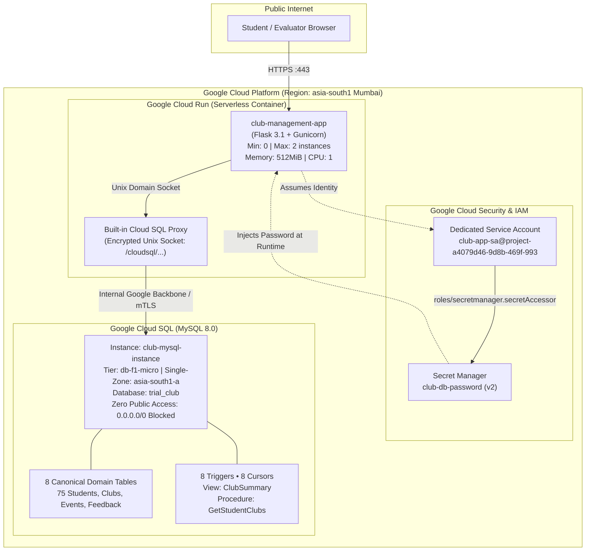

# College Club Management System (Cloud Deployment)

> **Google Cloud Platform Production Deployment** featuring live **Cloud SQL (MySQL 8.0)** database integration, **Secret Manager** credential encryption, least-privilege **IAM Service Account**, 8 automated database **triggers**, SQL **views**, and 8 **stored procedures with cursors**.

---

## 🌐 Live Production Deployment

| Service | Live URL / Endpoint | Details |
|---|---|---|
| **Web Application Dashboard** | [https://club-management-app-326279554484.asia-south1.run.app/](https://club-management-app-326279554484.asia-south1.run.app/) | Live Flask Web UI on Google Cloud Run |
| **8 Triggers Showcase** | [https://club-management-app-326279554484.asia-south1.run.app/triggers](https://club-management-app-326279554484.asia-south1.run.app/triggers) | Architectural catalog of all 8 production triggers |
| **8 Cursors & Procedures Hub** | [https://club-management-app-326279554484.asia-south1.run.app/procedures](https://club-management-app-326279554484.asia-south1.run.app/procedures) | Interactive execution runner for all 8 cursor procedures |
| **System & Database Health** | [https://club-management-app-326279554484.asia-south1.run.app/health](https://club-management-app-326279554484.asia-south1.run.app/health) | Real-time Cloud SQL Unix Socket ping |
| **Raw JSON Health Endpoint** | [https://club-management-app-326279554484.asia-south1.run.app/health?format=json](https://club-management-app-326279554484.asia-south1.run.app/health?format=json) | Automated uptime monitoring payload |

---

## 🏛️ System Architecture



---

## 🎯 Implementation Highlights (All 3 Evaluated Tracks)

### Track 1: Database Integration (Primary Focus)
1. **Cloud SQL MySQL 8.0:** Provisioned managed instance in Mumbai (`asia-south1-a`) with 10 GB SSD storage.
2. **Canonical Schema:** 8 fully normalized domain tables populated with real student records, club charters, events, memberships, and feedback.
3. **Database View (`ClubSummary`):** Clean abstraction joining `Clubs` with advisor metadata and live count statistics.
4. **8 Production Database Triggers (2 per Member across 4 Members):**
   - **Member 1:**
     - `trg_after_membership_insert_sync_count`: Increments `Clubs.member_count` on `AFTER INSERT ON Memberships`.
     - `trg_after_membership_delete_sync_count`: Decrements `Clubs.member_count` on `AFTER DELETE ON Memberships`.
   - **Member 2:**
     - `trg_prevent_multiple_presidents`: Enforces single-president rule via `SIGNAL SQLSTATE '45000'` on `BEFORE INSERT ON Memberships`.
     - `trg_adjust_member_count_on_status_change`: Dynamically adjusts counts on `Active <-> Inactive` on `AFTER UPDATE ON Memberships`.
   - **Member 3:**
     - `trg_prevent_registration_for_completed_event`: Rejects registrations on `Completed` or `Cancelled` events on `BEFORE INSERT ON EventRegistrations`.
     - `trg_verify_feedback_registration`: Verifies authentic registration prior to accepting event reviews on `BEFORE INSERT ON Feedback`.
   - **Member 4:**
     - `trg_auto_progress_event_on_attendance`: Flips event status from `Planned` to `Ongoing` upon first check-in on `AFTER UPDATE ON EventRegistrations`.
     - `trg_auto_create_club_profile`: Zero-config provisioning generating institutional email and Instagram handle on `AFTER INSERT ON Clubs`.
5. **8 Stored Procedures with Cursor Logic:**
   - `sp_audit_club_counts(p_fix)`: Loops clubs, verifies stored vs actual counts, and repairs drift.
   - `sp_recruitment_leads_and_auto_invite(min_events, auto_invite)`: Identifies prospective recruits from event participation and auto-enrolls as Volunteers.
   - `sp_reconcile_event_budgets(min_rating, bonus_pct, apply)`: Evaluates attendee feedback ratings and awards performance bonus budgets.
   - `sp_close_past_events(cutoff_date, apply)`: Reconciles past scheduled events to `Completed` or `Cancelled`.
   - `sp_deactivate_inactive_members(max_missed, apply)`: Deactivates chronic absentees and decrements club size.
   - `sp_award_active_contributors(student_id, min_attended, apply)`: Evaluates attendance and promotes regular members to `Core Member`.
   - `sp_senior_graduation_rollout(grad_year, apply)`: Transitions graduating final-year students (Year 4) to Alumni.
   - `sp_anonymize_sensitive_feedback(threshold, apply)`: Protects student identity on critical reviews with standardized tags.

### Track 2: Cloud Security & Identity
1. **Google Secret Manager:** Database passwords stored as encrypted versions; zero plaintext credentials in source code or Git history.
2. **Least-Privilege IAM Service Account (`club-app-sa`):**
   - Granted only `roles/cloudsql.client` and `roles/secretmanager.secretAccessor`.
   - Cannot create, alter, or delete cloud infrastructure if breached.
3. **Private Database Surface:** Cloud SQL instance has no authorized external networks (`0.0.0.0/0` strictly forbidden).
4. **Injection Immunity:** All SQL executions in `app/routes.py` use strictly parameterized queries (`%s` placeholders with tuple parameters).

### Track 3: Environment & Cloud Deployment
1. **Cloud Run Containerization:** Multi-stage Docker container served by production-grade Gunicorn WSGI workers.
2. **Autoscaling Bounds:** Scaled down to `min-instances=0` (scale-to-zero when idle for near-zero cost) and `max-instances=2` (hard cap against runaway compute billing).
3. **Monitoring & Health Checks:** Dedicated `/health` endpoint returning database latency, active engine version, and connection mode.

---

## 💻 Local Development Setup

### 1. Prerequisites
- Python 3.13+
- MySQL Server 8.0 running locally

### 2. Virtual Environment & Dependencies
```powershell
python -m venv venv
.\venv\Scripts\activate
pip install -r requirements.txt
```

### 3. Environment Configuration
Create a `.env` file in the root directory:
```env
DB_HOST=127.0.0.1
DB_PORT=3306
DB_USER=root
DB_PASSWORD=your_local_mysql_password
DB_NAME=trial_club
SECRET_KEY=dev-secret-key-vit-cloud-2026
```

### 4. Database Setup
```powershell
& "C:\Program Files\MySQL\MySQL Server 8.0\bin\mysql.exe" -u root -p trial_club < Club_Management_System_BASE.sql
& "C:\Program Files\MySQL\MySQL Server 8.0\bin\mysql.exe" -u root -p trial_club < triggers.sql
& "C:\Program Files\MySQL\MySQL Server 8.0\bin\mysql.exe" -u root -p trial_club < cursor.sql
```

### 5. Automated Tests & Local Server
```powershell
# Run the 11-test unit & integration test suite
pytest -v

# Run the local development server
python run.py
```
Visit `http://localhost:8080`.

---

## 🧹 Post-Interview Resource Teardown

To release all Google Cloud resources and eliminate ongoing charges after your interview evaluation:

```powershell
# 1. Delete Cloud Run Service
gcloud run services delete club-management-app --region=asia-south1 --quiet

# 2. Delete Cloud SQL MySQL Instance
gcloud sql instances delete club-mysql-instance --quiet

# 3. Delete Secret Manager Secret
gcloud secrets delete club-db-password --quiet

# 4. Delete Dedicated Service Account
gcloud iam service-accounts delete club-app-sa@project-a4079d46-9d8b-469f-993.iam.gserviceaccount.com --quiet
```
