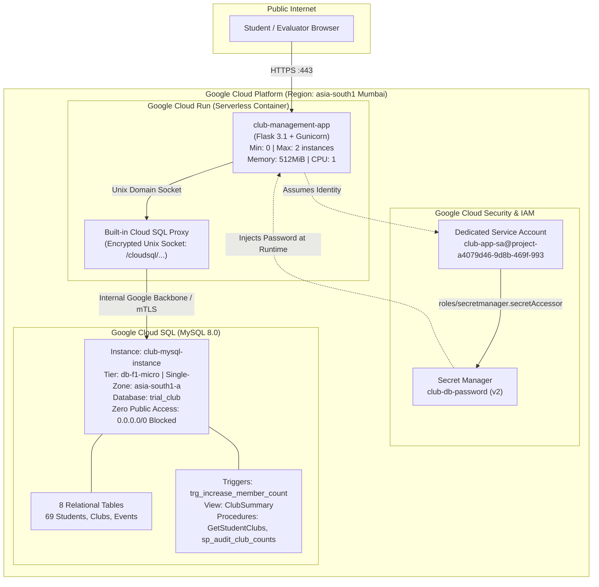

# College Club Management System (Cloud Deployment)

> **Google Cloud Platform Production Deployment** featuring live **Cloud SQL (MySQL 8.0)** database integration, **Secret Manager** credential encryption, least-privilege **IAM Service Account**, automated database **triggers**, SQL **views**, and **stored procedures**.

---

## 🌐 Live Production Deployment

| Service | Live URL / Endpoint | Details |
|---|---|---|
| **Web Application Dashboard** | [https://club-management-app-326279554484.asia-south1.run.app/](https://club-management-app-326279554484.asia-south1.run.app/) | Live Flask Web UI on Google Cloud Run |
| **System & Database Health** | [https://club-management-app-326279554484.asia-south1.run.app/health](https://club-management-app-326279554484.asia-south1.run.app/health) | Real-time Cloud SQL Unix Socket ping |
| **Raw JSON Health Endpoint** | [https://club-management-app-326279554484.asia-south1.run.app/health?format=json](https://club-management-app-326279554484.asia-south1.run.app/health?format=json) | Automated uptime monitoring payload |
| **Cursor Stored Procedure** | [https://club-management-app-326279554484.asia-south1.run.app/procedures/audit](https://club-management-app-326279554484.asia-south1.run.app/procedures/audit) | Executes `sp_audit_club_counts(IN p_fix TINYINT)` |
| **Relational Stored Procedure** | [https://club-management-app-326279554484.asia-south1.run.app/procedures/student-clubs](https://club-management-app-326279554484.asia-south1.run.app/procedures/student-clubs) | Executes `GetStudentClubs(IN p_student_id)` |

---

## 🏛️ System Architecture



---

## 🎯 Implementation Highlights (All 3 Evaluated Tracks)

### Track 1: Database Integration (Primary Focus)
1. **Cloud SQL MySQL 8.0:** Provisioned managed instance in Mumbai (`asia-south1-a`) with 10 GB SSD storage.
2. **Schema & Seed Data:** 8 fully normalized tables populated with real student records, club charters, events, and memberships.
3. **Database View (`ClubSummary`):** Clean abstraction joining `Clubs` with advisor metadata and live count statistics.
4. **Automated Database Triggers:**
   - `trg_increase_member_count`: Automatically increments `Clubs.member_count` on `AFTER INSERT` on `Memberships`.
   - `trg_decrease_member_count`: Automatically decrements `Clubs.member_count` on `AFTER DELETE` on `Memberships`.
   - `trg_update_member_count`: Handles status shifts (`Active` vs `Inactive`) on `AFTER UPDATE`.
5. **Stored Procedures with Cursor Logic:**
   - `GetStudentClubs(p_student_id)`: Parameterized procedure querying student memberships via relational joins.
   - `sp_audit_club_counts(p_fix)`: Advanced cursor loop iterating over clubs, reconciling denormalized counters with membership rows, with optional automated self-healing (`p_fix = 1`).

### Track 2: Cloud Security & Identity
1. **Google Secret Manager:** Database passwords stored as encrypted versions; zero plaintext credentials in source code or Git history.
2. **Least-Privilege IAM Service Account (`club-app-sa`):**
   - Granted only `roles/cloudsql.client` and `roles/secretmanager.secretAccessor`.
   - Cannot create, alter, or delete cloud infrastructure if breached.
3. **Private Database Surface:** Cloud SQL instance has no authorized external networks (`0.0.0.0/0` strictly forbidden).
4. **Injection Immunity:** All SQL executions in `app/routes.py` use strictly parameterized queries (`%s` placeholders with tuple parameters).

### Track 3: Environment & Cloud Deployment
1. **Cloud Run Containerization:** Multi-stage Docker container served by production-grade Gunicorn WSGI workers.
2. **Autoscaling Bounds:** Scaled down to `min-instances=0` (scale-to-zero when idle for near-zero cost) and `max-instances=2` (hard cap against runaway compute billing).
3. **Monitoring & Health Checks:** Dedicated `/health` endpoint returning database latency, active engine version, and connection mode.

---

## 💻 Local Development Setup

### 1. Prerequisites
- Python 3.13+
- MySQL Server 8.0 running locally

### 2. Virtual Environment & Dependencies
```powershell
python -m venv venv
.\venv\Scripts\activate
pip install -r requirements.txt
```

### 3. Environment Configuration
Create a `.env` file in the root directory:
```env
DB_HOST=127.0.0.1
DB_PORT=3306
DB_USER=root
DB_PASSWORD=your_local_mysql_password
DB_NAME=trial_club
SECRET_KEY=dev-secret-key-vit-cloud-2026
```

### 4. Database Setup
```powershell
& "C:\Program Files\MySQL\MySQL Server 8.0\bin\mysql.exe" -u root -p trial_club < Club_Management_System_BASE.sql
& "C:\Program Files\MySQL\MySQL Server 8.0\bin\mysql.exe" -u root -p trial_club < triggers.sql
& "C:\Program Files\MySQL\MySQL Server 8.0\bin\mysql.exe" -u root -p trial_club < cursor.sql
```

### 5. Automated Tests & Local Server
```powershell
# Run the 8-test unit & integration test suite
pytest -v

# Run the local development server
python run.py
```
Visit `http://localhost:8080`.

---

## 🧹 Post-Interview Resource Teardown

To release all Google Cloud resources and eliminate ongoing charges after your interview evaluation:

```powershell
# 1. Delete Cloud Run Service
gcloud run services delete club-management-app --region=asia-south1 --quiet

# 2. Delete Cloud SQL MySQL Instance
gcloud sql instances delete club-mysql-instance --quiet

# 3. Delete Secret Manager Secret
gcloud secrets delete club-db-password --quiet

# 4. Delete Dedicated Service Account
gcloud iam service-accounts delete club-app-sa@project-a4079d46-9d8b-469f-993.iam.gserviceaccount.com --quiet
```

