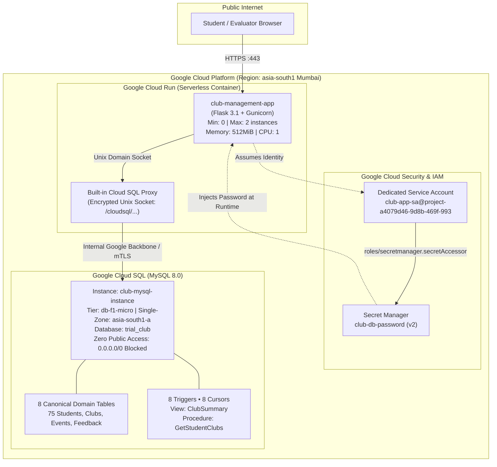

# College Club Management System (Cloud Deployment)

> **Google Cloud Platform Production Deployment** featuring live **Cloud SQL (MySQL 8.0)** database integration, **Secret Manager** credential encryption, least-privilege **IAM Service Account**, 8 automated database **triggers**, SQL **views**, and 8 **stored procedures with cursors**.

---

## 🌐 Live Production Deployments

| Service | Live URL / Endpoint | Details |
|---|---|---|
| **Primary Web Distribution (Vercel)** | [https://cloud-chi-six.vercel.app](https://cloud-chi-six.vercel.app) | Global Edge Serverless Web UI with Gatekeeper Auth & Guest Evaluator |
| **GCP Cloud Run Production App** | [https://club-management-app-326279554484.asia-south1.run.app/](https://club-management-app-326279554484.asia-south1.run.app/) | Live Flask Web UI on Google Cloud Run (Mumbai asia-south1) |
| **8 Triggers Showcase & Trigger 1 DDL** | [https://cloud-chi-six.vercel.app/triggers](https://cloud-chi-six.vercel.app/triggers) | Architectural catalog of all 8 production triggers + Trigger 1 Spotlight |
| **8 Cursors & Procedures Hub** | [https://cloud-chi-six.vercel.app/procedures](https://cloud-chi-six.vercel.app/procedures) | Interactive execution runner for all 8 cursor procedures |
| **8 Golden Rules Audit Report (PDF)** | [https://cloud-chi-six.vercel.app/8_golden_rules.pdf](https://cloud-chi-six.vercel.app/8_golden_rules.pdf) | 13-page formal compliance audit against Ben Shneiderman's 8 Golden Rules |
| **System & Database Health** | [https://cloud-chi-six.vercel.app/health](https://cloud-chi-six.vercel.app/health) | Real-time Cloud SQL Unix Socket ping |

---

## 📚 Evaluation & Demonstration Resources

- **[Viva & Demo Script](docs/DEMO_SCRIPT.md)**: Complete step-by-step presentation walkthrough for faculty evaluation.
- **[Interview & Viva Prep](docs/INTERVIEW_PREP.md)**: Comprehensive technical Q&A on MySQL triggers, cursors, normal forms, and RBAC.
- **[Engineering Learning Notes](docs/LEARNING_NOTES.md)**: Deep dive into schema normalization, BCNF, ACID transactions, and design tokens.
- **[8 Golden Rules PDF](docs/8_golden_rules.pdf)**: Comprehensive 13-page UI/UX audit report.

---

## 🏛️ System Architecture



---

## 👥 Universal 75-Student Authentication Catalog & Role Hierarchy

ClubHub Enterprise DBMS comes pre-seeded with **all 75 students and institutional faculty** directly in the authentication engine. Evaluators and students can log in immediately with **zero signup hurdles**.

### Built-in Identity Rule: Username == Password
- **Student Members & Core Members:**
  - Login Email: `<name>.<prn>@vit.edu`
  - Password: `<name>.<prn>@vit.edu` (or `password123`)
  - *Example:* `hemanya.1251070718@vit.edu` with password `hemanya.1251070718@vit.edu`
- **Club Presidents (1 Active President per Club):**
  - CSI: `aditya.12410214.president@vit.edu`
  - SWD: `tanmay.12410220.president@vit.edu`
  - EDC: `siddhesh.1251070268.president@vit.edu`
  - ZEPHYR: `mayur.12410215.president@vit.edu`
  - Password: Same as email address (or `password123`)
- **Club Secretaries & Event Coordinators (Identical Tier):**
  - Login Email: `<name>.<prn>.secretary@vit.edu` or `<name>.<prn>.coordinator@vit.edu`
  - Password: Same as email address (or `password123`)
- **Super Admin / Principal:**
  - `sharma.principal@vit.edu` with password `sharma.principal@vit.edu` (or `password123`)
- **Faculty Demonstration Guest Access:**
  - One-click top-right **Guest** button with **100% unrestricted access** across all 8 triggers, 8 cursors, and CRUD tables.

### Role Authorization Matrix:

| Role Persona | Permitted Triggers | Permitted Stored Procedures | Event Actions |
|---|---|---|---|
| **Student Member / Core Member** | Trigger 1 (Enrolment), Trigger 5 (Registration check), Trigger 6 (Review verification) | None (Read-only catalog inspection) | Self-service registration & verified feedback (auto-bound to student ID) |
| **Club Secretary / Coordinator** | Triggers 1, 2, 4, 5, 6, 7 | Procs 2 (Recruitment), 3 (Budgets), 4 (Close events), 5 (Deactivate absentees) | Full event scheduling, attendance check-in, and attendee management |
| **Club President** | Triggers 1, 2, 3 (Single-President rule), 5, 6, 8 | Procs 1 (Audit counts), 6 (Promote core members), 7 (Graduation rollout), 8 (Anonymize feedback) | Executive club governance, charter editing, and merit promotions |
| **Super Admin / Guest Evaluator** | All 8 Triggers (1 through 8) | All 8 Cursors (1 through 8) | Unrestricted master access across all domain tables |

---

## 🎨 Ben Shneiderman's 8 Golden Rules UX Implementation

ClubHub's dark architectural interface was audited and refactored under Ben Shneiderman's 8 Golden Rules of Interface Design:

1. **Strive for Consistency:** Unified token scale (`tokens.css`), 4-tier button system, standardized 56px table rows, consistent Modal/Sheet structures, and unified institutional terminology.
2. **Seek Universal Usability:** Full keyboard navigation, modal focus traps, global shortcuts (`/` search, `?` shortcuts guide, `Esc` dismiss), WCAG AA color contrast, and `prefers-reduced-motion` compliance.
3. **Offer Informative Feedback:** Immediate interactive responses: Google Pay style rotating rainbow celebration overlay on authentication, live database heartbeat status, and accessible screen-reader toast notifications (`aria-live`).
4. **Design Dialogs to Yield Closure:** All multi-step workflows (charter creation, event registration, reviews) feature clear progression badges, pre-submission review summaries, and distinct completion confirmation states.
5. **Prevent Errors:** Real-time email role regex detection, client-side capacity/date validations, destructive action safeguards, and friendly error recovery.
6. **Permit Easy Reversal of Actions:** Pre-destruction confirmation dialogs for all deletes, accessible Cancel buttons, and reversible status toggles (`Active` ↔ `Inactive`).
7. **Keep Users in Control:** Top-right 1-Click Guest Evaluator button for unconstrained demonstration, explicit role persona switcher, and non-blocking navigation drawer.
8. **Reduce Short-Term Memory Load:** Universal breadcrumbs on all inner pages, inline SQL code inspectors for triggers and stored procedures, automatic form draft persistence in `localStorage`, and contextual help tooltips.

---

## 📐 Zero-Clipping Table Architecture
To eliminate header clipping across all viewports and browsers:
- Fixed navigation bar is given 80px clearance via `main#main-content { padding-top: 80px; }`.
- Tables use `border-collapse: separate; border-spacing: 0;` with `position: static;` on `thead` to eliminate Chromium stacking context bugs where headers overlap the first row.
- Explicit `scroll-margin-top: 120px;` on table rows and anchor targets ensures navigation never cuts off Trigger 1 or row 1.
- Fully responsive tables with smooth horizontal scrolling (`overflow-x: auto; overflow-y: visible !important;`).

---

### Track 1: Database Integration (Primary Focus)
1. **Cloud SQL MySQL 8.0:** Provisioned managed instance in Mumbai (`asia-south1-a`) with 10 GB SSD storage.
2. **Canonical Schema:** 8 fully normalized domain tables populated with real student records, club charters, events, memberships, and feedback.
3. **Database View (`ClubSummary`):** Clean abstraction joining `Clubs` with advisor metadata and live count statistics.
4. **8 Production Database Triggers (4 Core Architectural Modules):**
   - **Module 1: Membership Lifecycle & Count Synchronization:**
     - `trg_after_membership_insert_sync_count`: Increments `Clubs.member_count` on `AFTER INSERT ON Memberships`.
     - `trg_after_membership_delete_sync_count`: Decrements `Clubs.member_count` on `AFTER DELETE ON Memberships`.
   - **Module 2: Governance & Single-President Bylaws:**
     - `trg_prevent_multiple_presidents`: Enforces single-president rule via `SIGNAL SQLSTATE '45000'` on `BEFORE INSERT ON Memberships`.
     - `trg_adjust_member_count_on_status_change`: Dynamically adjusts counts on `Active <-> Inactive` on `AFTER UPDATE ON Memberships`.
   - **Module 3: Event Lifecycle & Authentic Feedback Integrity:**
     - `trg_prevent_registration_for_completed_event`: Rejects registrations on `Completed` or `Cancelled` events on `BEFORE INSERT ON EventRegistrations`.
     - `trg_verify_feedback_registration`: Verifies authentic registration prior to accepting event reviews on `BEFORE INSERT ON Feedback`.
   - **Module 4: State Progression & Zero-Config Provisioning:**
     - `trg_auto_progress_event_on_attendance`: Flips event status from `Planned` to `Ongoing` upon first check-in on `AFTER UPDATE ON EventRegistrations`.
     - `trg_auto_create_club_profile`: Zero-config provisioning generating institutional email and Instagram handle on `AFTER INSERT ON Clubs`.
5. **8 Stored Procedures with Cursor Logic:**
   - `sp_audit_club_counts(p_fix)`: Loops clubs, verifies stored vs actual counts, and repairs drift.
   - `sp_recruitment_leads_and_auto_invite(min_events, auto_invite)`: Identifies prospective recruits from event participation and auto-enrolls as Volunteers.
   - `sp_reconcile_event_budgets(min_rating, bonus_pct, apply)`: Evaluates attendee feedback ratings and awards performance bonus budgets.
   - `sp_close_past_events(cutoff_date, apply)`: Reconciles past scheduled events to `Completed` or `Cancelled`.
   - `sp_deactivate_inactive_members(max_missed, apply)`: Deactivates chronic absentees and decrements club size.
   - `sp_award_active_contributors(student_id, min_attended, apply)`: Evaluates attendance and promotes regular members to `Core Member`.
   - `sp_senior_graduation_rollout(grad_year, apply)`: Transitions graduating final-year students (Year 4) to Alumni.
   - `sp_anonymize_sensitive_feedback(threshold, apply)`: Protects student identity on critical reviews with standardized tags.

### Track 2: Cloud Security & Identity
1. **Google Secret Manager:** Database passwords stored as encrypted versions; zero plaintext credentials in source code or Git history.
2. **Least-Privilege IAM Service Account (`club-app-sa`):**
   - Granted only `roles/cloudsql.client` and `roles/secretmanager.secretAccessor`.
   - Cannot create, alter, or delete cloud infrastructure if breached.
3. **Private Database Surface:** Cloud SQL instance has no authorized external networks (`0.0.0.0/0` strictly forbidden).
4. **Injection Immunity:** All SQL executions in `app/routes.py` use strictly parameterized queries (`%s` placeholders with tuple parameters).

### Track 3: Environment & Cloud Deployment
1. **Cloud Run Containerization:** Multi-stage Docker container served by production-grade Gunicorn WSGI workers.
2. **Autoscaling Bounds:** Scaled down to `min-instances=0` (scale-to-zero when idle for near-zero cost) and `max-instances=2` (hard cap against runaway compute billing).
3. **Monitoring & Health Checks:** Dedicated `/health` endpoint returning database latency, active engine version, and connection mode.

---

## 💻 Local Development Setup

### 1. Prerequisites
- Python 3.13+
- MySQL Server 8.0 running locally

### 2. Virtual Environment & Dependencies
```powershell
python -m venv venv
.\venv\Scripts\activate
pip install -r requirements.txt
```

### 3. Environment Configuration
Create a `.env` file in the root directory:
```env
DB_HOST=127.0.0.1
DB_PORT=3306
DB_USER=root
DB_PASSWORD=your_local_mysql_password
DB_NAME=trial_club
SECRET_KEY=dev-secret-key-vit-cloud-2026
```

### 4. Database Setup
```powershell
& "C:\Program Files\MySQL\MySQL Server 8.0\bin\mysql.exe" -u root -p trial_club < Club_Management_System_BASE.sql
& "C:\Program Files\MySQL\MySQL Server 8.0\bin\mysql.exe" -u root -p trial_club < triggers.sql
& "C:\Program Files\MySQL\MySQL Server 8.0\bin\mysql.exe" -u root -p trial_club < cursor.sql
```

### 5. Automated Tests & Local Server
```powershell
# Run the 11-test unit & integration test suite
pytest -v

# Run the local development server
python run.py
```
Visit `http://localhost:8080`.

---

## 🧹 Post-Interview Resource Teardown

To release all Google Cloud resources and eliminate ongoing charges after your interview evaluation:

```powershell
# 1. Delete Cloud Run Service
gcloud run services delete club-management-app --region=asia-south1 --quiet

# 2. Delete Cloud SQL MySQL Instance
gcloud sql instances delete club-mysql-instance --quiet

# 3. Delete Secret Manager Secret
gcloud secrets delete club-db-password --quiet

# 4. Delete Dedicated Service Account
gcloud iam service-accounts delete club-app-sa@project-a4079d46-9d8b-469f-993.iam.gserviceaccount.com --quiet
```
